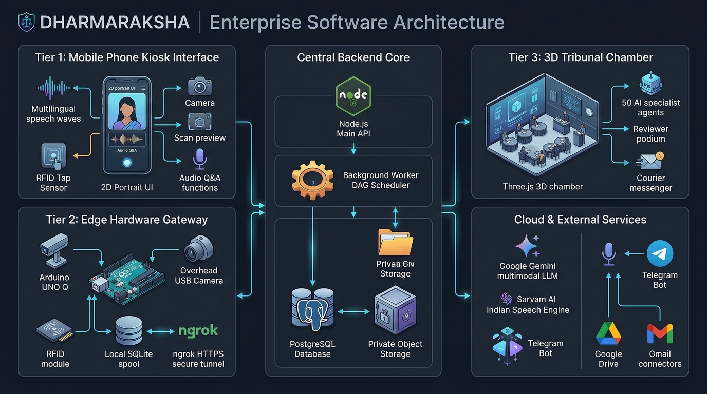

# DHARMARAKSHA — Complete System Architecture Blueprint

> **DHARMARAKSHA**: An Indian legal-document assistance system providing preliminary AI-assisted document review, obligation mapping, adversarial cross-examination, and plain-language explanation across English and Indian languages (Kannada, Hindi, Tamil, Telugu).

---

## 1. System Architecture Diagram (Visual Format)

*Direct image file locations:*
- **PNG format:** `docs/dharmaraksha_architecture_diagram.png`
- **JPEG format:** `docs/dharmaraksha_architecture_diagram.jpg`
- **Interactive HTML Blueprint:** `docs/architecture-diagram.html`

---

## 2. Complete Mermaid Architecture Diagram

```mermaid
flowchart TD
    %% Styling Classes
    classDef phone fill:#1e293b,stroke:#38bdf8,stroke-width:2px,color:#f8fafc;
    classDef gateway fill:#1e293b,stroke:#f59e0b,stroke-width:2px,color:#f8fafc;
    classDef laptop fill:#1e293b,stroke:#10b981,stroke-width:2px,color:#f8fafc;
    classDef benchA fill:#1e293b,stroke:#38bdf8,stroke-width:2px,color:#f8fafc;
    classDef benchB fill:#1e293b,stroke:#34d399,stroke-width:2px,color:#f8fafc;
    classDef benchC fill:#1e293b,stroke:#fbbf24,stroke-width:2px,color:#f8fafc;
    classDef benchD fill:#1e293b,stroke:#f87171,stroke-width:2px,color:#f8fafc;
    classDef benchE fill:#1e293b,stroke:#c084fc,stroke-width:2px,color:#f8fafc;
    classDef official fill:#312e81,stroke:#818cf8,stroke-width:2px,color:#f8fafc;
    classDef database fill:#0f172a,stroke:#60a5fa,stroke-width:2px,color:#f8fafc;
    classDef cloud fill:#3b0764,stroke:#d8b4fe,stroke-width:2px,color:#f8fafc;

    %% -------------------------------------------------------------
    %% TIER 1: KIOSK PHONE
    %% -------------------------------------------------------------
    subgraph TIER_1 ["TIER 1: KIOSK PHONE (apps/phone-web)"]
        P1["Visitor Tap & RFID Prompt<br/>(3000ms debounce)"]:::phone
        P2["Language & Consent Selector<br/>(Kannada, Hindi, Tamil, Telugu, English)"]:::phone
        P3["Multi-Document Scanner View<br/>(Reorder, Rotate, Retake, Delete, Annexures)"]:::phone
        P4["Real-Time Progress & Review Trigger<br/>(Case Snapshot Submission)"]:::phone
        P5["Grounded Conversational Q&A<br/>(Mic / Speaker, Captions, Typed Turns)"]:::phone
        P6["Referenced Report & Delivery View<br/>(Telegram, Google Drive, Gmail Triggers)"]:::phone
    end

    %% -------------------------------------------------------------
    %% NETWORK HOP 1
    %% -------------------------------------------------------------
    P3 -->|"Hop 1: HTTPS (ngrok tunnel or LAN)<br/>Port 5000 &bull; Pairing Cookie (dhr_pair)"| G_NET

    %% -------------------------------------------------------------
    %% TIER 2: UNO Q HARDWARE GATEWAY
    %% -------------------------------------------------------------
    subgraph TIER_2 ["TIER 2: ARDUINO UNO Q GATEWAY (apps/uno-gateway)"]
        G_NET["Gateway Router & Security Middleware<br/>(CSRF &bull; Origin Check &bull; Cookie Auth)"]:::gateway
        G_PAIR["Pairing Service<br/>(Single-Use Codes DK-XXXXXX, QR URL)"]:::gateway
        G_CAM["Hardware Overhead UVC Camera<br/>(/dev/video0 &bull; 1080p Still &bull; 640x480 Preview)"]:::gateway
        G_RFID["Hardware RFID Reader Adapter<br/>(RC522 / Serial &bull; Monotonic Tap Ledger)"]:::gateway
        G_SPOOL["Bounded SQLite Spool Buffer<br/>(Max 20 Captures / 50MB Ceiling)"]:::gateway
        G_MGR["Capture Manager<br/>(SHA-256 Pre-hashing &bull; Retry Interrupted Uploads)"]:::gateway
        G_TUNNEL["Tunnel Supervisor<br/>(ngrok ARM64 Daemon &bull; LAN HTTPS Fallback)"]:::gateway
    end

    G_NET --- G_PAIR
    G_CAM --> G_MGR
    G_RFID --> G_MGR
    G_MGR --> G_SPOOL
    G_MGR -->|"Hop 2: HTTP/HTTPS REST (Port 4000)<br/>Header: X-Dharmaraksha-Device-Key"| L_API

    %% -------------------------------------------------------------
    %% TIER 3: CENTRAL LAPTOP HOST & BACKEND
    %% -------------------------------------------------------------
    subgraph TIER_3 ["TIER 3: LAPTOP HOST & CENTRAL BACKEND"]
        
        %% Laptop Web Shell
        subgraph L_UI ["Laptop Web Interface (apps/laptop-web)"]
            L_3D["3D Tribunal Chamber<br/>(Three.js / React Three Fiber / Drei &bull; 60 FPS)<br/>5 Round Tables &bull; 50 Seats &bull; Evidence Well &bull; Podium"]:::laptop
            L_FOLIO["Warm Paper Folio Workspace<br/>(Split View &bull; Light Folio + Ink Chamber)"]:::laptop
            L_2D["Accessible 2D Fallback View<br/>(Full Inspection Outside WebGL)"]:::laptop
            L_EVAL["Evaluator Presentation View<br/>(Milestone Handoffs &bull; Zero Raw Secrets)"]:::laptop
        end

        %% Main API
        subgraph L_API_SRV ["Central Main API (apps/main-api)"]
            L_API["Express REST Server (Port 4000)<br/>(Cases &bull; Sessions &bull; Documents &bull; Snapshots)"]:::laptop
            L_AUTH["requireCaseAccess Middleware<br/>(Session Binding &bull; Multi-Tenant Isolation)"]:::laptop
            L_OCR["Indian Script OCR Engine<br/>(Kannada, Devanagari, Latin &bull; >1000 Chars &bull; Tables)"]:::laptop
            L_QA["QaTurnService<br/>(Scope Filter &bull; Ambiguity Clarification &bull; Comparison)"]:::laptop
            L_LEDGER["EventLedgerService<br/>(Monotonic Event Stream &bull; SSE / WebSockets)"]:::laptop
        end

        %% Background Worker & DAG
        subgraph L_WRK ["Background Worker & Orchestration DAG (apps/worker)"]
            W_SCHED["Durable Task Scheduler<br/>(Claims &bull; Leases &bull; 30s Timeout &bull; Recovery)"]:::laptop
            W_INDEX["Case-Restricted BM25 Lexical Index<br/>(Verbatim Passages &bull; Exact Anchors)"]:::laptop
            W_VAL["Post-Synthesis Grounding Validator<br/>(Strict vs Partial Publication Policy)"]:::laptop
        end

        %% Database & File Storage
        subgraph L_DATA ["Authoritative Persistence & Storage"]
            DB[("PostgreSQL 15+ Central DB<br/>19 Relational Tables<br/>cases &bull; sessions &bull; documents &bull; findings")]:::database
            STORE[("Private Document Store<br/>./storage/documents/{caseId}/{docId}/<br/>AES-256 Encrypted at Rest")]:::database
            CORPUS[("Curated Indian Legal Corpus<br/>Transfer of Property &bull; Contract Act<br/>Rent Acts &bull; Consumer Protection &bull; SC Law")]:::database
        end
    end

    %% Laptop Web Connections
    L_API <-->|"SSE Milestones & REST State"| L_UI
    L_API --> L_AUTH
    L_API --> L_OCR
    L_API --> L_QA
    L_API --> L_LEDGER
    L_API --> DB
    L_API --> STORE

    %% Worker Connections
    W_SCHED --> DB
    W_INDEX --> STORE
    W_INDEX --> CORPUS

    %% -------------------------------------------------------------
    %% 50 SPECIALIST BENCHES & DAG FLOW
    %% -------------------------------------------------------------
    subgraph TRIBUNAL_CHAMBER ["⚖️ THE 50 SPECIALIST BENCHES (packages/tribunal-definitions)"]
        
        %% STAGE 1: BENCH A
        subgraph STAGE_1 ["STAGE 1: DOCUMENT & EVIDENCE"]
            direction TB
            BA["BENCH A (A01–A09)<br/>A01 Capture Quality &bull; A02 Page Continuity<br/>A03 Text Fidelity &bull; A04 Language Analyst<br/>A05 Parties &bull; A06 Dates/Amounts &bull; A07 Clause Structure<br/>A08 Consistency &bull; A09 Sensitive Data"]:::benchA
            A10["A10 Evidence Chair<br/>(Consolidated Evidence Packet)"]:::benchA
            BA --> A10
        end

        %% STAGE 2: BENCHES B & C
        subgraph STAGE_2 ["STAGE 2: OBLIGATIONS & STATUTORY SOURCES"]
            direction TB
            BB["BENCH B (B01–B09)<br/>B01 General Contract &bull; B02 Employment<br/>B03 Tenancy &bull; B04 Property Transaction<br/>B05 Consumer &bull; B06 MSME Business<br/>B07 Lending &bull; B08 Data/IP &bull; B09 Exit/Dispute"]:::benchB
            B10["B10 Obligations Chair<br/>(Obligations Packet)"]:::benchB
            BB --> B10

            BC["BENCH C (C01–C09)<br/>C01 Jurisdiction &bull; C02 Statute Retrieval<br/>C03 State-Law &bull; C04 Rules & Notifications<br/>C05 Temporal Applicability &bull; C06 Precedent Retrieval<br/>C07 Precedent Relevance &bull; C08 Contrary Authority<br/>C09 Citation Verifier"]:::benchC
            C10["C10 Sources Chair<br/>(Verified Authorities Packet)"]:::benchC
            BC --> C10
        end

        %% STAGE 3: BENCH D
        subgraph STAGE_3 ["STAGE 3: ADVERSARIAL RISK & DISSENT"]
            direction TB
            BD["BENCH D (D01–D09)<br/>D01 Document-Holder Advocate vs D02 Counterparty Advocate<br/>D03 Ambiguity Analyst &bull; D04 Financial Exposure<br/>D05 Deadline/Default &bull; D06 Balance/Fairness<br/>D07 Evidence-Gap &bull; D08 Red-Flag &bull; D09 Scenarios"]:::benchD
            D10["D10 Risk Chair<br/>(Preserved Dissent & Risk Packet)"]:::benchD
            BD --> D10
        end

        %% STAGE 4: BENCH E
        subgraph STAGE_4 ["STAGE 4: VERIFICATION & EXPLANATION"]
            direction TB
            BE["BENCH E (E01–E09)<br/>E01 Evidence Auditor &bull; E02 Contradiction Resolver<br/>E03 Arithmetic/Timeline &bull; E04 Coverage Auditor<br/>E05 Plain-Language Editor &bull; E06 Multilingual Fidelity<br/>E07 Clarification Planner &bull; E08 Human Triage<br/>E09 Privacy Reviewer"]:::benchE
            E10["E10 Verification Chair<br/>(Final Release Status Packet)"]:::benchE
            BE --> E10
        end

        %% CHAMBER OFFICIALS
        MESSENGER["📬 DETERMINISTIC MESSENGER<br/>(Packet Validator &bull; SHA-256 Deduplication &bull; Courier Transit Path)"]:::official
        PRESIDING["🏛️ AI PRESIDING REVIEWER<br/>(Elevated Podium &bull; Synthesis of 5 Packets &bull; Dissent Preservation)"]:::official
    end

    %% DAG Stage Progressions
    W_SCHED --> STAGE_1
    A10 -->|"Stage 1 Complete: Evidence Established"| STAGE_2
    B10 & C10 -->|"Stage 2 Complete: Obligations & Authority"| STAGE_3
    D10 -->|"Stage 3 Complete: Adversarial Challenges"| STAGE_4

    %% Courier Delivery Flow
    A10 & B10 & C10 & D10 & E10 -->|"Versioned Packets"| MESSENGER
    MESSENGER -->|"Idempotent Delivery (duplicate_ignored)"| PRESIDING
    PRESIDING -->|"Consolidated Presiding Summary"| W_VAL
    W_VAL -->|"Verified Report / Findings"| DB

    %% -------------------------------------------------------------
    %% EXTERNAL CLOUD INTEGRATIONS
    %% -------------------------------------------------------------
    subgraph CLOUD_INTEGRATIONS ["REMOTE CLOUD PROVIDERS & INTEGRATIONS"]
        GEMINI["Google Gemini 1.5 / 2.0 API<br/>(Multi-Document Legal Reasoning &bull; Synthesis)"]:::cloud
        SARVAM["Sarvam AI Indian Speech Engine<br/>(Multilingual STT & TTS &bull; Indian Accents)"]:::cloud
        TG["Telegram Bot Service<br/>(Visitor Notifications &bull; Report Dispatch)"]:::cloud
        GDRIVE["Google Drive API<br/>(Authorized PDF Case Report Export)"]:::cloud
        GMAIL["Gmail SMTP Dispatcher<br/>(App-Password Email Sender)"]:::cloud
    end

    %% External Connections
    W_SCHED <-->|"Inference Dispatch"| GEMINI
    P5 <-->|"Audio STT / TTS"| SARVAM
    L_API -->|"Report Export"| TG
    L_API -->|"Report Export"| GDRIVE
    L_API -->|"Report Export"| GMAIL
```

---

## 3. Comprehensive Text Architecture Breakdown

### 3.1 Tier 1: Kiosk Phone Interface (`apps/phone-web`)
- **Runtime & Constraints**: Lightweight portrait 2D responsive web application. Built with Vite, React, and TypeScript. **Zero 3D/Three.js assets** in the phone bundle to ensure instantaneous loading on low-power mobile devices.
- **Visitor Journey Flow**:
  1. *RFID Tap*: Prompts visitor to tap their issued operator card; debounced with a 3000ms window.
  2. *Language & Consent*: Explicit consent capture and selection of primary operating language (Kannada, Hindi, Tamil, Telugu, English).
  3. *Multi-Document Capture*: Page review, rotation (0°, 90°, 180°, 270°), retake, reorder, delete, and annexure linkage (linking attachments to parent agreements).
  4. *Case Submission*: Creates an immutable case-document snapshot (e.g. `v1 -> v2`) and triggers analysis.
  5. *Grounded Voice/Text Q&A*: Live captions, conversational turn interface with audio mute/stop controls powered by Sarvam AI.
  6. *Referenced Report & Delivery*: Summary of findings, risk severity ratings, and visitor-triggered export to Telegram, Google Drive, or Gmail.
- **Security & Authorization**: Uses an HttpOnly, Secure, `SameSite=Strict` pairing cookie (`dhr_pair`). Enforces CSRF/Origin validation. Holds **zero cloud API secrets** or device keys.

---

### 3.2 Tier 2: Arduino UNO Q Hardware Gateway (`apps/uno-gateway`)
- **Hardware Architecture**: Arduino UNO Q board running ARM64 Linux paired with an onboard microcontroller co-processor via internal Bridge / CDC_ACM communication.
- **Peripheral Management**:
  - **Overhead Document Camera**: Linux UVC driver (`/dev/video0`). Generates high-res 1080p still captures for document processing and bounded 640x480 live preview frames (capped at 5 FPS to preserve ngrok bandwidth).
  - **RFID Reader**: RC522 or USB serial RFID reader daemon monitoring tap events, emitting single-tap IDs with monotonic timestamps.
- **Core Daemons & Services**:
  - `CaptureManager`: Native peripheral owner. Executes cryptographic SHA-256 pre-hashing, local buffering, and transmission to Main API. Implements offline interruption recovery with stable page identities.
  - `SpoolService`: Embedded SQLite database (`/tmp/dharmaraksha_spool.db`). Enforces strict bounding: max 20 captures / 50MB ceiling with automatic 507 disk-pressure backoff. Auto-evicts local files upon receiving Main API `UploadAcknowledgment`.
  - `PairingService`: Issues single-use pairing codes (`DK-XXXXXX`) for kiosk phones, creates ephemeral QR payloads without embedding device secrets, and prevents concurrent session takeovers.
  - `TunnelSupervisor`: Manages ngrok daemon lifecycle and provides `/api/v1/connectivity` separating tunnel status from Main API status.
- **Authentication**: Scoped device key provided in the `X-Dharmaraksha-Device-Key` header.

---

### 3.3 Tier 3: Laptop Host & Central Backend

#### A. Laptop Web Client (`apps/laptop-web`)
- **3D Tribunal Chamber**: Built with Three.js, React Three Fiber (R3F), and Drei. Renders at 60 FPS.
  - 5 round-table benches with 10 specialist seats each (50 seats total).
  - Central evidence well visualizing ingested document folios and snapshots.
  - Elevated Presiding Reviewer podium.
  - Real-time specialist gestures (reading, listening, note-taking, discussion, packet handover) driven by WebSocket/SSE events.
  - Visible walking Courier Messenger animating packet handoffs along floor paths.
- **Split Workspace**: Dual-pane workspace pairing a warm light paper document folio with the ink-dark 3D tribunal chamber.
- **Accessible 2D Fallback & Evaluator Clean View**: Full task completion (document inspection, Q&A, report review) without WebGL. Dedicated presentation mode hiding raw developer logs and API credentials.

#### B. Main API Server (`apps/main-api`)
- **Core Engine**: Node.js and Express REST API (port 4000). Authoritative manager for cases, sessions, RFID cards, documents, pages, snapshots, and reports.
- **Indian Script OCR Pipeline**: Multi-script text extraction (Kannada, Devanagari, Latin). Extracts complete documents (>1,000 characters without truncation), preserving tabular columns, dates, amounts, negations, and uncertainty audit flags.
- **Grounded Q&A Service (`QaTurnService`)**:
  - Scoping: Questions scoped to a single document (`specific`) or all case documents (`all`).
  - Ambiguity Clarification: Detects ambiguous references ("this agreement") across multi-document cases and asks focused clarification questions without guessing.
  - Discrepancy Calculation: Calculates numerical variances across documents (e.g. INR 20,000 difference between lease and payment receipt).
  - Zero Hallucination: Declares absent information (`absent_from_documents`) without fabricating contract clauses.
  - Status Distinctions: Distinguishes preliminary unreviewed OCR text (`preliminary_unreviewed`) from completed tribunal review findings (`tribunal_verified`).
  - Targeted Legal Tasks: Dispatches focused specialist reviews (e.g. B09) for complex queries without re-running the 50-agent chamber.
- **Monotonic Event Ledger (`EventLedgerService`)**: Append-only event store broadcasting SSE updates (`bench:packet_ready`, `messenger:transit_started`, `report:ready_for_review`).

#### C. Background Worker & Orchestration DAG (`apps/worker`)
- **4-Stage Specialist Execution DAG**:
  - **Stage 1 (Bench A)**: Document & Evidence quality, page continuity, text fidelity.
  - **Stage 2 (Benches B & C)**: Contractual obligations and Indian legal authority matching.
  - **Stage 3 (Bench D)**: Adversarial risk analysis, counterparty advocacy, and financial exposure.
  - **Stage 4 (Bench E)**: Cross-verification, contradiction resolution, arithmetic auditing, plain language, and multilingual fidelity.
- **Task Claim Store**: Bounded scheduling with durable claims, leases, 30s timeouts, retry budgets, and crash recovery.
- **Contradiction Round Without Majority Voting**: Independent assessments followed by structured adversarial challenges; disagreements are preserved rather than averaged out.
- **Bench Chair Packet Consolidation**: Chairs A10, B10, C10, D10, E10 consolidate findings into versioned packets with SHA-256 checksums.
- **Deterministic Messenger Courier**: Validates checksums and delivers packets to the Presiding Reviewer idempotently (`duplicate_ignored`).
- **AI Presiding Reviewer Synthesis**: Synthesizes verified packets into executive summaries, core obligations, material concerns, questions for the visitor, and limitations.
- **Post-Synthesis Citation Grounding Validator**: Enforces publication policies (strict blocking vs partial publication) and validates every cited passage against stored document pages.

---

### 3.4 The 50 Specialist Identities (`@dharmaraksha/tribunal-definitions`)

| Bench | Specialists | Core Mandate |
| :--- | :--- | :--- |
| **Bench A: Evidence** | **A01** Capture Quality &bull; **A02** Page Continuity &bull; **A03** Text Fidelity &bull; **A04** Language &bull; **A05** Parties &bull; **A06** Dates & Amounts &bull; **A07** Clause Structure &bull; **A08** Consistency &bull; **A09** Sensitive Data &bull; **A10 Evidence Chair** | Establish what documents actually say, flag unreadable scans, missing pages, and extract verbatim text. |
| **Bench B: Obligations** | **B01** Contract &bull; **B02** Employment &bull; **B03** Tenancy &bull; **B04** Property &bull; **B05** Consumer &bull; **B06** MSME Small-Business &bull; **B07** Lending &bull; **B08** Data/IP &bull; **B09** Exit & Dispute &bull; **B10 Obligations Chair** | Extract promises, covenants, default triggers, notice periods, payment schedules, and lock-in terms. |
| **Bench C: Legal Sources** | **C01** Jurisdiction &bull; **C02** Statute Retrieval &bull; **C03** State-Law &bull; **C04** Rules & Notifications &bull; **C05** Temporal Applicability &bull; **C06** Precedents &bull; **C07** Precedent Relevance &bull; **C08** Contrary Authority &bull; **C09** Citation Verifier &bull; **C10 Sources Chair** | Validate statutory authority against Transfer of Property Act, Contract Act, Rent Acts, and Supreme Court precedent. |
| **Bench D: Adversarial Risk** | **D01** Document-Holder Advocate &bull; **D02** Counterparty Advocate &bull; **D03** Ambiguity &bull; **D04** Financial Exposure &bull; **D05** Deadlines &bull; **D06** Fairness &bull; **D07** Evidence-Gap &bull; **D08** Red-Flags &bull; **D09** Scenarios &bull; **D10 Risk Chair** | Present best counter-arguments, identify uncapped liabilities, penal clauses, and preserve genuine dissent. |
| **Bench E: Verification** | **E01** Evidence Auditor &bull; **E02** Contradiction Resolver &bull; **E03** Math & Timeline &bull; **E04** Coverage &bull; **E05** Plain-Language Editor &bull; **E06** Multilingual Fidelity &bull; **E07** Clarification Planner &bull; **E08** Human Triage &bull; **E09** Privacy &bull; **E10 Verification Chair** | Verify arithmetic, reconcile dates, audit citation traceability, ensure faithful Indian language translation, and package release status. |
| **Officials** | **Messenger** (Courier & Validator) &bull; **AI Presiding Reviewer** (Podium Synthesis) | Coordinate packet handoffs and produce the final consolidated case review. |

---

### 3.5 Authoritative Persistence & Cloud Integrations

#### PostgreSQL 15+ Central Database (19 Authoritative Tables)
1. `cases`: Central case metadata, snapshot version, current status, language preferences.
2. `sessions`: Operator-issued visitor sessions, expiration timestamps, card bindings.
3. `rfid_cards`: Physical card tracking, UID hashing, issuance status, reassignment counters.
4. `documents`: Multi-document metadata, title, category, parent-annexure relations.
5. `document_pages`: Page order, rotation, capture source, SHA-256 pre-hashes, extraction status.
6. `document_snapshots`: Immutable versioned cases (`v1`, `v2`, ...) with combined document fingerprints.
7. `specialist_tasks`: Scheduled tasks mapped to specific specialist IDs (A01–E10).
8. `task_claims`: Durable worker claims, lease deadlines, worker IDs, and retry budgets.
9. `findings`: Verbatim passages, clause references, risk severities, and source anchors.
10. `adversarial_contradictions`: Document-Holder (D01) vs Counterparty (D02) preserved dissents.
11. `bench_packets`: Versioned packets consolidated by chairs A10–E10 with cryptographic checksums.
12. `presiding_summaries`: Consolidated synthesis, core obligations, limitations, and questions.
13. `event_ledger`: Monotonic append-only event stream powering SSE/WebSocket updates.
14. `idempotency_keys`: Cryptographic deduplication store for requests and packet deliveries.
15. `qa_turns`: Grounded question-and-answer turns with scope, status, and citation anchors.
16. `reports`: Generated referenced PDF reports, release statuses, publication policies.
17. `devices`: Authorized hardware devices, gateway API keys, heartbeat tracking.
18. `delivery_records`: Telegram, Drive, and Gmail dispatch audit logs.
19. `statutory_corpus`: Pre-curated Indian legal enactments, sections, and precedent anchors.

#### Private Document Object Storage
- Filesystem: `./storage/documents/{caseId}/{docId}/original/` and `thumbnails/`.
- Security: AES-256 encryption at rest, path traversal protection, streaming authentication via session token.

#### Remote Cloud Integrations
- **Google Gemini 1.5 / 2.0 API**: Complex legal reasoning, cross-document discrepancy detection, adversarial analysis, and synthesis.
- **Sarvam AI Speech Engine**: Multilingual Indian speech recognition (STT) and native voice generation (TTS) with Indian accents.
- **Telegram Bot API**: Visitor report dispatch and status notification.
- **Google Drive API**: OAuth 2.0 authorized report PDF upload to visitor's Google Drive.
- **Gmail SMTP Dispatcher**: App-Password authenticated email sender for final referenced reports.
- **Mandatory Statutory Disclaimer**: Prominently enforced across all surfaces stating the system provides preliminary AI assistance and **NOT** formal human legal advice or an advocate-on-record opinion.
