# DHARMARAKSHA — Complete System Architecture (Mermaid Diagram)

> **File Path:** [`docs/MERMAID_DIAGRAM.md`](file:///c:/Users/moune/OneDrive/Desktop/dharmaraksak/docs/MERMAID_DIAGRAM.md)  
> **Raw Mermaid File:** [`docs/architecture.mmd`](file:///c:/Users/moune/OneDrive/Desktop/dharmaraksak/docs/architecture.mmd)  
> **High-Res Architecture Image (PNG):** [`docs/dharmaraksha_architecture_diagram.png`](file:///c:/Users/moune/OneDrive/Desktop/dharmaraksak/docs/dharmaraksha_architecture_diagram.png)  
> **Interactive HTML Blueprint:** [`docs/architecture-diagram.html`](file:///c:/Users/moune/OneDrive/Desktop/dharmaraksak/docs/architecture-diagram.html)

---

## 1. How to View This Mermaid Diagram

You can view this diagram in multiple ways:
1. **Directly in VS Code / Cursor**: If you have the "Markdown Preview Mermaid Support" extension or standard Markdown preview (`Ctrl+Shift+V`), it will render immediately.
2. **On GitHub**: Open [`https://github.com/mouneshbelavadi/dharmarakshak/blob/master/docs/MERMAID_DIAGRAM.md`](https://github.com/mouneshbelavadi/dharmarakshak/blob/master/docs/MERMAID_DIAGRAM.md) in your browser — GitHub natively renders Mermaid diagrams into interactive SVG charts!
3. **Mermaid Live Editor**: Copy the Mermaid code below and paste it into [mermaid.live](https://mermaid.live).

---

## 2. Complete End-to-End System Workflow Diagram

```mermaid
flowchart TD
    %% Styling Classes
    classDef phone fill:#1e293b,stroke:#38bdf8,stroke-width:2px,color:#f8fafc;
    classDef gateway fill:#1e293b,stroke:#f59e0b,stroke-width:2px,color:#f8fafc;
    classDef laptop fill:#1e293b,stroke:#10b981,stroke-width:2px,color:#f8fafc;
    classDef benchA fill:#1e293b,stroke:#38bdf8,stroke-width:2px,color:#f8fafc;
    classDef benchB fill:#1e293b,stroke:#34d399,stroke-width:2px,color:#f8fafc;
    classDef benchC fill:#1e293b,stroke:#fbbf24,stroke-width:2px,color:#f8fafc;
    classDef benchD fill:#1e293b,stroke:#f87171,stroke-width:2px,color:#f8fafc;
    classDef benchE fill:#1e293b,stroke:#c084fc,stroke-width:2px,color:#f8fafc;
    classDef official fill:#312e81,stroke:#818cf8,stroke-width:2px,color:#f8fafc;
    classDef database fill:#0f172a,stroke:#60a5fa,stroke-width:2px,color:#f8fafc;
    classDef cloud fill:#3b0764,stroke:#d8b4fe,stroke-width:2px,color:#f8fafc;

    %% -------------------------------------------------------------
    %% TIER 1: KIOSK PHONE
    %% -------------------------------------------------------------
    subgraph TIER_1 ["TIER 1: KIOSK PHONE (apps/phone-web)"]
        P1["Visitor Tap & RFID Prompt<br/>(3000ms debounce)"]:::phone
        P2["Language & Consent Selector<br/>(Kannada, Hindi, Tamil, Telugu, English)"]:::phone
        P3["Multi-Document Scanner View<br/>(Reorder, Rotate, Retake, Delete, Annexures)"]:::phone
        P4["Real-Time Progress & Review Trigger<br/>(Case Snapshot Submission)"]:::phone
        P5["Grounded Conversational Q&A<br/>(Mic / Speaker, Captions, Typed Turns)"]:::phone
        P6["Referenced Report & Delivery View<br/>(Telegram, Google Drive, Gmail Triggers)"]:::phone
    end

    %% -------------------------------------------------------------
    %% NETWORK HOP 1
    %% -------------------------------------------------------------
    P3 -->|"Hop 1: HTTPS (ngrok tunnel or LAN)<br/>Port 5000 &bull; Pairing Cookie (dhr_pair)"| G_NET

    %% -------------------------------------------------------------
    %% TIER 2: UNO Q HARDWARE GATEWAY
    %% -------------------------------------------------------------
    subgraph TIER_2 ["TIER 2: ARDUINO UNO Q GATEWAY (apps/uno-gateway)"]
        G_NET["Gateway Router & Security Middleware<br/>(CSRF &bull; Origin Check &bull; Cookie Auth)"]:::gateway
        G_PAIR["Pairing Service<br/>(Single-Use Codes DK-XXXXXX, QR URL)"]:::gateway
        G_CAM["Hardware Overhead UVC Camera<br/>(/dev/video0 &bull; 1080p Still &bull; 640x480 Preview)"]:::gateway
        G_RFID["Hardware RFID Reader Adapter<br/>(RC522 / Serial &bull; Monotonic Tap Ledger)"]:::gateway
        G_SPOOL["Bounded SQLite Spool Buffer<br/>(Max 20 Captures / 50MB Ceiling)"]:::gateway
        G_MGR["Capture Manager<br/>(SHA-256 Pre-hashing &bull; Retry Interrupted Uploads)"]:::gateway
        G_TUNNEL["Tunnel Supervisor<br/>(ngrok ARM64 Daemon &bull; LAN HTTPS Fallback)"]:::gateway
    end

    G_NET --- G_PAIR
    G_CAM --> G_MGR
    G_RFID --> G_MGR
    G_MGR --> G_SPOOL
    G_MGR -->|"Hop 2: HTTP/HTTPS REST (Port 4000)<br/>Header: X-Dharmaraksha-Device-Key"| L_API

    %% -------------------------------------------------------------
    %% TIER 3: CENTRAL LAPTOP HOST & BACKEND
    %% -------------------------------------------------------------
    subgraph TIER_3 ["TIER 3: LAPTOP HOST & CENTRAL BACKEND"]
        
        %% Laptop Web Shell
        subgraph L_UI ["Laptop Web Interface (apps/laptop-web)"]
            L_3D["3D Tribunal Chamber<br/>(Three.js / React Three Fiber / Drei &bull; 60 FPS)<br/>5 Round Tables &bull; 50 Seats &bull; Evidence Well &bull; Podium"]:::laptop
            L_FOLIO["Warm Paper Folio Workspace<br/>(Split View &bull; Light Folio + Ink Chamber)"]:::laptop
            L_2D["Accessible 2D Fallback View<br/>(Full Inspection Outside WebGL)"]:::laptop
            L_EVAL["Evaluator Presentation View<br/>(Milestone Handoffs &bull; Zero Raw Secrets)"]:::laptop
        end

        %% Main API
        subgraph L_API_SRV ["Central Main API (apps/main-api)"]
            L_API["Express REST Server (Port 4000)<br/>(Cases &bull; Sessions &bull; Documents &bull; Snapshots)"]:::laptop
            L_AUTH["requireCaseAccess Middleware<br/>(Session Binding &bull; Multi-Tenant Isolation)"]:::laptop
            L_OCR["Indian Script OCR Engine<br/>(Kannada, Devanagari, Latin &bull; >1000 Chars &bull; Tables)"]:::laptop
            L_QA["QaTurnService<br/>(Scope Filter &bull; Ambiguity Clarification &bull; Comparison)"]:::laptop
            L_LEDGER["EventLedgerService<br/>(Monotonic Event Stream &bull; SSE / WebSockets)"]:::laptop
        end

        %% Background Worker & DAG
        subgraph L_WRK ["Background Worker & Orchestration DAG (apps/worker)"]
            W_SCHED["Durable Task Scheduler<br/>(Claims &bull; Leases &bull; 30s Timeout &bull; Recovery)"]:::laptop
            W_INDEX["Case-Restricted BM25 Lexical Index<br/>(Verbatim Passages &bull; Exact Anchors)"]:::laptop
            W_VAL["Post-Synthesis Grounding Validator<br/>(Strict vs Partial Publication Policy)"]:::laptop
        end

        %% Database & File Storage
        subgraph L_DATA ["Authoritative Persistence & Storage"]
            DB[("PostgreSQL 15+ Central DB<br/>19 Relational Tables<br/>cases &bull; sessions &bull; documents &bull; findings")]:::database
            STORE[("Private Document Store<br/>./storage/documents/{caseId}/{docId}/<br/>AES-256 Encrypted at Rest")]:::database
            CORPUS[("Curated Indian Legal Corpus<br/>Transfer of Property &bull; Contract Act<br/>Rent Acts &bull; Consumer Protection &bull; SC Law")]:::database
        end
    end

    %% Laptop Web Connections
    L_API <-->|"SSE Milestones & REST State"| L_UI
    L_API --> L_AUTH
    L_API --> L_OCR
    L_API --> L_QA
    L_API --> L_LEDGER
    L_API --> DB
    L_API --> STORE

    %% Worker Connections
    W_SCHED --> DB
    W_INDEX --> STORE
    W_INDEX --> CORPUS

    %% -------------------------------------------------------------
    %% 50 SPECIALIST BENCHES & DAG FLOW
    %% -------------------------------------------------------------
    subgraph TRIBUNAL_CHAMBER ["⚖️ THE 50 SPECIALIST BENCHES (packages/tribunal-definitions)"]
        
        %% STAGE 1: BENCH A
        subgraph STAGE_1 ["STAGE 1: DOCUMENT & EVIDENCE"]
            direction TB
            BA["BENCH A (A01–A09)<br/>A01 Capture Quality &bull; A02 Page Continuity<br/>A03 Text Fidelity &bull; A04 Language Analyst<br/>A05 Parties &bull; A06 Dates/Amounts &bull; A07 Clause Structure<br/>A08 Consistency &bull; A09 Sensitive Data"]:::benchA
            A10["A10 Evidence Chair<br/>(Consolidated Evidence Packet)"]:::benchA
            BA --> A10
        end

        %% STAGE 2: BENCHES B & C
        subgraph STAGE_2 ["STAGE 2: OBLIGATIONS & STATUTORY SOURCES"]
            direction TB
            BB["BENCH B (B01–B09)<br/>B01 General Contract &bull; B02 Employment<br/>B03 Tenancy &bull; B04 Property Transaction<br/>B05 Consumer &bull; B06 MSME Business<br/>B07 Lending &bull; B08 Data/IP &bull; B09 Exit/Dispute"]:::benchB
            B10["B10 Obligations Chair<br/>(Obligations Packet)"]:::benchB
            BB --> B10

            BC["BENCH C (C01–C09)<br/>C01 Jurisdiction &bull; C02 Statute Retrieval<br/>C03 State-Law &bull; C04 Rules & Notifications<br/>C05 Temporal Applicability &bull; C06 Precedent Retrieval<br/>C07 Precedent Relevance &bull; C08 Contrary Authority<br/>C09 Citation Verifier"]:::benchC
            C10["C10 Sources Chair<br/>(Verified Authorities Packet)"]:::benchC
            BC --> C10
        end

        %% STAGE 3: BENCH D
        subgraph STAGE_3 ["STAGE 3: ADVERSARIAL RISK & DISSENT"]
            direction TB
            BD["BENCH D (D01–D09)<br/>D01 Document-Holder Advocate vs D02 Counterparty Advocate<br/>D03 Ambiguity Analyst &bull; D04 Financial Exposure<br/>D05 Deadline/Default &bull; D06 Balance/Fairness<br/>D07 Evidence-Gap &bull; D08 Red-Flag &bull; D09 Scenarios"]:::benchD
            D10["D10 Risk Chair<br/>(Preserved Dissent & Risk Packet)"]:::benchD
            BD --> D10
        end

        %% STAGE 4: BENCH E
        subgraph STAGE_4 ["STAGE 4: VERIFICATION & EXPLANATION"]
            direction TB
            BE["BENCH E (E01–E09)<br/>E01 Evidence Auditor &bull; E02 Contradiction Resolver<br/>E03 Arithmetic/Timeline &bull; E04 Coverage Auditor<br/>E05 Plain-Language Editor &bull; E06 Multilingual Fidelity<br/>E07 Clarification Planner &bull; E08 Human Triage<br/>E09 Privacy Reviewer"]:::benchE
            E10["E10 Verification Chair<br/>(Final Release Status Packet)"]:::benchE
            BE --> E10
        end

        %% CHAMBER OFFICIALS
        MESSENGER["📬 DETERMINISTIC MESSENGER<br/>(Packet Validator &bull; SHA-256 Deduplication &bull; Courier Transit Path)"]:::official
        PRESIDING["🏛️ AI PRESIDING REVIEWER<br/>(Elevated Podium &bull; Synthesis of 5 Packets &bull; Dissent Preservation)"]:::official
    end

    %% DAG Stage Progressions
    W_SCHED --> STAGE_1
    A10 -->|"Stage 1 Complete: Evidence Established"| STAGE_2
    B10 & C10 -->|"Stage 2 Complete: Obligations & Authority"| STAGE_3
    D10 -->|"Stage 3 Complete: Adversarial Challenges"| STAGE_4

    %% Courier Delivery Flow
    A10 & B10 & C10 & D10 & E10 -->|"Versioned Packets"| MESSENGER
    MESSENGER -->|"Idempotent Delivery (duplicate_ignored)"| PRESIDING
    PRESIDING -->|"Consolidated Presiding Summary"| W_VAL
    W_VAL -->|"Verified Report / Findings"| DB

    %% -------------------------------------------------------------
    %% EXTERNAL CLOUD INTEGRATIONS
    %% -------------------------------------------------------------
    subgraph CLOUD_INTEGRATIONS ["REMOTE CLOUD PROVIDERS & INTEGRATIONS"]
        GEMINI["Google Gemini 1.5 / 2.0 API<br/>(Multi-Document Legal Reasoning &bull; Synthesis)"]:::cloud
        SARVAM["Sarvam AI Indian Speech Engine<br/>(Multilingual STT & TTS &bull; Indian Accents)"]:::cloud
        TG["Telegram Bot Service<br/>(Visitor Notifications &bull; Report Dispatch)"]:::cloud
        GDRIVE["Google Drive API<br/>(Authorized PDF Case Report Export)"]:::cloud
        GMAIL["Gmail SMTP Dispatcher<br/>(App-Password Email Sender)"]:::cloud
    end

    %% External Connections
    W_SCHED <-->|"Inference Dispatch"| GEMINI
    P5 <-->|"Audio STT / TTS"| SARVAM
    L_API -->|"Report Export"| TG
    L_API -->|"Report Export"| GDRIVE
    L_API -->|"Report Export"| GMAIL
```

